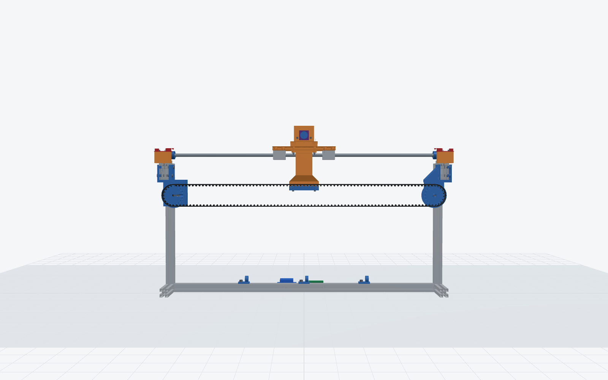
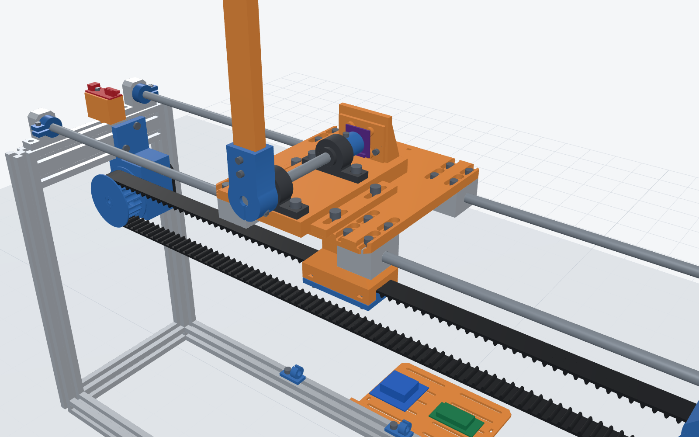
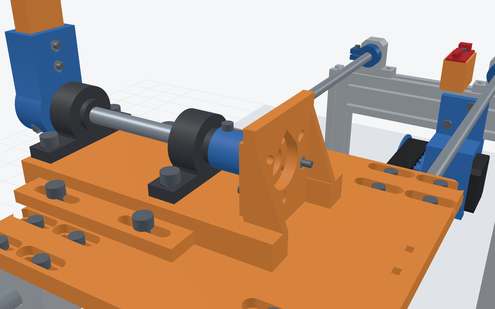
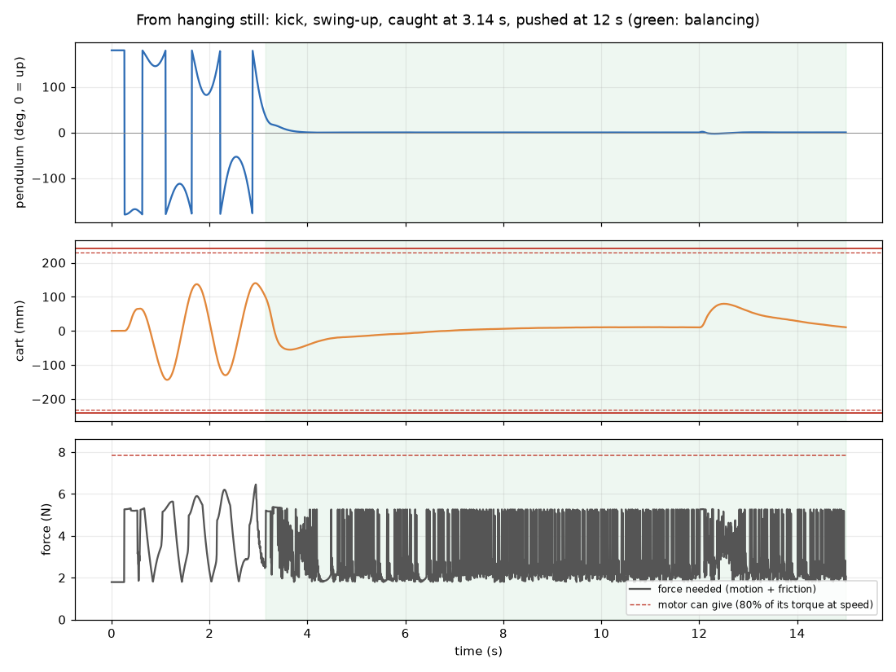

# Design

Every number here comes from `scripts/params.py` (geometry) and `parts/sim.json` (dynamics); the
gate (`scripts/check_parts.py`) checks them. Coordinates: x along the rails (+x = idler end, −x =
motor end), y from the front (−) to the back (+), z up from the desk; origin at the centre of the
frame's footprint.

## Key numbers

| | |
|---|---|
| Frame (yours, estimated) | 560 × 280 × 300 mm, 2020 posts and bottom members, 2040 top end bars on edge |
| Rails (yours) | 2 × 8 mm × 600 mm rods on SK8 supports, 180 mm apart, axes 320 mm above the desk |
| Carriage | 4 × SC8UU under a 150 × 226 × 8 mm printed plate; 0.83 kg moving, belt and spinning parts included |
| Travel | ±178 mm to the bumpers (356 mm), limit switches trip at ±174, firmware keeps to ±168 |
| Belt | HTD 5M, 15 mm; both pulleys 30 teeth (pitch Ø 47.75 mm, 150 mm per turn), axles 226 mm up, 542 mm apart |
| Belt length | closed loop 1234 mm at the nominal idler, 1214–1254 mm within the tensioner's travel; open belt: cut 1244 mm |
| Motor | your NEMA 17: 0.4 N m holding, half of it relied on: 8.4 N at the cart; 21.33 steps/mm at 1/16 microstep |
| Pivot | 8 mm × 115 mm shaft in 2 × KP08, 70 mm apart, axis 366 mm up; the arm turns 8 mm in front of the frame |
| Pendulum | 20 × 10 mm PLA arm, 300 mm from the axis to the tip; 112 g turning, CG 70 mm out, 1.71 × 10⁻³ kg m² about the axis |
| Sensor | AS5600 (12 bit) with a diametric magnet on the shaft's end, or a 600 P/R optical encoder |
| Control (model) | swings up in 4.9 s (≤ 5.9 s with ±20 % model error), cart within ±84 mm; LQR K = [−22.4, −16.0, −57.5, −8.6] |
| Prints | 21 part files, 6 plates: PLA 404 g / 16.1 h, PETG 201 g / 8.3 h |

## Measure first

The frame's size was estimated from the photos. Before printing, measure and put these in
`scripts/params.py`, then run `python scripts/build_all.py`; the gate re-checks every clearance:

| Name | What to measure | Estimate | Slack in the design |
|---|---|---|---|
| `FRAME_L` | length between the end frames' outer faces | 560 | the pulleys follow the end frames |
| `FRAME_W` | width across the posts' outer faces | 280 | bridge slides ±10 mm: 260–300 wide fit |
| `FRAME_H` | desk to the top of the top end bars | 300 | everything is placed from the bars |
| `ROD_SPACING` | rod centre to rod centre | 180 | SC8UU holes slotted ±5 mm: 170–190 fit |
| `ROD_L` | rod length | 600 | |
| belt | marking on its back; closed loop or cut | HTD 5M-15 | loop 1214–1254 mm, or open |

## How the belt runs now

The belt is a vertical loop in **one plane, the frame's centre line (y = 0)**, round two equal
pulleys whose axles sit at the **same height (z 226)**, so both runs are level and parallel to the
rails, and the clamp grips the upper run in that same plane, under the carriage's centre (no twist
on the carriage). The pulleys stay where yours were, in the end frames under the 2040 top end
bars, so the belt length hardly changes.

**Motor end** (`motor_mount`, PETG). A saddle wraps the −x top end bar from below: a cheek on each
of its 40 mm faces (two M5 + T-nuts each) and a web under it. The motor hangs under the web, its
face on a 7 mm plate with the four M3 heads sunk 3.2 mm so the pulley's back flange (1 mm away)
clears them, between two side walls and on a floor: it cannot twist under belt pull. The shaft
points forward to the pulley; the body sits behind (+y), clear of the carriage.

**Pulleys** (`motor_pulley`, `idler_pulley`, PETG). 30 teeth, HTD 5M grooves (circular, 2.2 mm deep),
17 mm toothed width for the 15 mm belt, a 27 mm flange printed on each and a second flange
(`pulley_flange`) pressed on the front boss after assembly, so the belt has a flange on both sides
with 1 mm to spare. The motor pulley has a D bore whose flat faces a radial M3 × 12 set screw: its
head is sunk below the teeth, its nut captive in a slot under the front flange. Tighten it before
pressing the flange on. The idler turns on `idler_sleeve`.

**Idler end** (`idler_mount`, `idler_slider` × 2, PETG). The same saddle on the +x top end bar, with
two cheeks either side of the idler. Each cheek has a window in which a slider runs along x; the
M5 × 40 axle passes slider – sleeve – slider. An M3 × 30 from an outboard lug into each slider
pulls it out:

1. Leave the axle nut finger-tight. Turn both tension screws evenly until the upper span deflects
   about 6–8 mm when you press its middle with about 200 g (about 35–40 N of tension).
2. Run the cart by hand from end to end. If the belt creeps towards one flange, give that side's
   screw a quarter turn more (the axle squares itself to the belt) and repeat.
3. Tighten the axle nut: it clamps the sliders' flanges against the cheeks. The sleeve takes the
   clamping, so the pulley still turns freely.

**Clamp** (`belt_clamp` PLA, `clamp_jaw` PETG). The upper run is 82 mm below the carriage plate, so
the clamp is a box column (40 × 24 mm, 3 mm walls, flared 45° into the jaw seat) on four M3 × 16
from the plate's top. The belt lies in a 16 mm channel under a flat ceiling on its back; the jaw
comes up from below with 14 HTD tooth seats in phase with the belt's teeth and pulls up on four
M3 × 12 into nuts in the column's side walls. An open belt goes in from both ends, about 30 mm
(6 teeth) each; a closed loop passes straight through. Nothing slips and there is no play
between the cart and the belt.

**Lower run** passes 30 mm under the jaw's screw heads. The cart never reaches the pulleys: the
SC8UU blocks stop on the bumpers first.

## Carriage

- `carriage_plate` (PLA, 8 mm): four SC8UU blocks underneath (16 × M4 × 10, heads sunk; holes
  slotted ±5 mm in y so the plate fits rods 170–190 mm apart without binding: set the blocks on the
  rods, then tighten). Four M5 nuts in pockets underneath take the bridge; four M3 counterbores take
  the clamp. Two zip-tie bridges at the back edge hold the sensor lead.
- `pivot_bridge` (PLA): carries both KP08s in line (4 × M5 × 16, nuts in pockets underneath), the
  front one over the plate's front edge. Its side flanges are slotted ±10 mm (4 × M5 × 20): slide it
  until the arm turns 8 mm in front of the frame's front face. At its back end the 5 mm **sensor
  tower** stands on the shaft's axis.

## Pendulum

- Shaft: 8 mm × 115 mm steel, through both KP08s (their set screws hold it) into the hub.
- `pendulum_hub` (PETG): split below the bore, one M3 × 20 pinch screw; the arm in a 25 mm socket
  with 2 × M3 × 20 through.
- `pendulum_arm` (PLA, prints diagonally): 20 × 10 mm, its 20 mm in the plane it swings in;
  `pendulum_tip` caps it (M3 × 20 pin; room for washers if you want more tip mass: re-run `sim.py`
  with the new mass).
- It turns a full circle at every cart position: the hub, arm and tip stay in front of the frame
  (y −162 to −144) and the tip clears the desk by 64 mm when it hangs (gate: `pendulum`).

## Angle sensor

**AS5600 (default).** `magnet_cap` (PETG) goes on the shaft's back end (M3 × 8 set screw) with the
6 × 2.5 mm diametric magnet glued in its pocket, on the axis. `as5600_mount` (PLA) bolts to the
tower's front face (2 × M3 × 12, nuts in the tower's back) and carries the board on four raised,
slotted pads (M2.5 self-tapping, or M3, in the board's corner holes, 18–26 mm apart), chip
towards the magnet, 1.5 mm air gap. Solder its header facing forward (or use the side pads).

**600 P/R optical encoder (option).** Leave out the cap and the adapter; bolt the encoder to the
tower's back face (3 × M3 into its holes on a 28–32 mm circle, its boss through the tower's
window) and join the shafts with `coupler` (PETG, slotted beam coupling: it takes up the
misalignment between the KP08s and the encoder's bearings). The viewer's "optical encoder" button
shows it.

## Travel ends and homing

`rod_bumper` collars (4, PETG, M3 × 12 clamp) sit against the SK8s' inner faces: the SC8UU blocks
stop on them at ±178 mm. A `switch_mount` on each top end bar (one M5 into a T-nut, keyed in the
bar's top slot) holds a mechanical endstop level with the plate; its roller trips at ±174 mm.

Homing: move −x slowly to the −x switch, back off 5 mm, set x = −169 (the trip point less the
back-off); then centre. Keep the controller within ±168 mm.

## Control

The model (`scripts/sim.py`) is the cart-pole of this machine: cart 0.72 kg + belt 0.08 kg + motor
rotor and pulleys 0.03 kg reflected = 0.83 kg; pendulum 112 g with its CG 70 mm from the axis and
1.71 × 10⁻³ kg m² about it (sliced masses, steel shaft, screws). Natural frequency 6.7 rad/s.

- **Input = cart acceleration.** A stepper sets motion, not force; the force it takes is checked
  against half the holding torque at the pulley (8.4 N): peak 7.5 N on the model, 8.6 N in its
  worst variant (3 % over; the gate allows 15 %, and the full holding torque gives 16.8 N). The
  cart never goes faster than 0.53 m/s (210 rpm), where a NEMA 17 keeps most of its torque.
  Acceleration limit 7.1 m/s², speed 1.5 m/s.
- **Balance:** LQR on [x, ẋ, θ, θ̇] (θ = 0 up, positive towards +x), Q = diag(1000, 80, 60, 2),
  R = 2: **u = 22.36 x + 16.05 ẋ + 57.52 θ + 8.62 θ̇** (SI units, u in m/s²). Closed-loop poles
  −9.5, −5.6, −4.1 ± 1.5i.
- **Swing-up:** energy pumping, u = −2.59 tanh(3 (E_ref − E)/(m g l)) tanh(2 θ̇ cos θ / ω₀) − 2.68 x −
  1.92 ẋ, aiming at E_ref = 0.172 m g l above the upright rest energy; switch to the LQR when
  |θ| < 11.2° and |θ̇| < 4 rad/s, back to swing-up if |θ| > 45°.
- **Result:** from hanging still, upright in 4.9 s; the cart stays within ±80 mm; balanced, the
  pendulum holds within 0.04° RMS (AS5600 resolution 0.088°); a 1 rad/s kick is absorbed. Over ±20 %
  error in the pendulum's mass, inertia and CG and +20 % cart mass: every variant swings up and
  holds, the cart within ±84 mm.
- **Firmware:** 200 Hz loop; read the AS5600 over I²C (or count the optical encoder's edges);
  unwrap the angle; θ̇ from successive readings through a first-order filter (α ≈ 0.35);
  steps/mm = 3200 / 150 = 21.33.

## Electronics and leads

`electronics_tray` (PLA) lies on the desk behind the frame, hooked to the back long member (2 ×
M5 into T-nuts in its outer slot), with M3 slots for the stepper-driver carrier and the
controller and zip-tie slots. Run the motor and switch leads along the frame in `cable_clip`s
(M5 + T-nut into any slot). Take the sensor lead from the carriage's zip-tie bridges up and over in
a loose loop to the tray: allow 400 mm of slack for the full travel.

## Assembly order

1. **Measure** (above), rebuild, print `petg_1_belt_drive` and check the saddles on the bars.
2. **Motor end.** Drop four T-nuts into the −x top end bar's 40 mm faces, slide the saddle up under
   the bar, bolt it (M5 × 10). Motor into the U from behind, four M3 × 8 from the front.
3. **Motor pulley.** M3 nut into its slot, pulley onto the shaft with the screw on the flat, axles
   flush; tighten; press on the front flange (a drop of CA).
4. **Idler end.** Saddle on the +x bar as above. Idler: sleeve into the pulley, front flange on,
   then slider – sleeve – slider on the M5 × 40, nut finger-tight; tension screws in from the lugs.
5. **Carriage.** SC8UU blocks on the rods; plate on them (M4 × 10, loose), slide the cart end to end
   and tighten the screws with the blocks parallel. Bumpers on the rods against the SK8s.
6. **Clamp.** Nuts into the column's flange pockets and side slots; column under the plate (4 × M3 ×
   16 from the top). Belt round both pulleys, its upper run into the channel; jaw up from below
   (4 × M3 × 12). An open belt: both ends in the channel, teeth in the seats.
7. **Tension** (above).
8. **Pivot.** M5 nuts into the bridge's pockets; KP08s on (M5 × 16); bridge on the plate (M5 × 20,
   washers), slid so the arm will turn 8 mm in front of the frame. Shaft through both KP08s, hub on
   its front end, magnet cap on its back end; KP08 set screws, then the hub's pinch screw. Arm into
   the hub (2 × M3 × 20), tip on.
9. **Sensor.** AS5600 on the adapter, adapter on the tower, 1.5 mm from the magnet.
10. **Switches, tray, clips, leads.** Then home, check the travel by hand, and run.
