<div align="center">

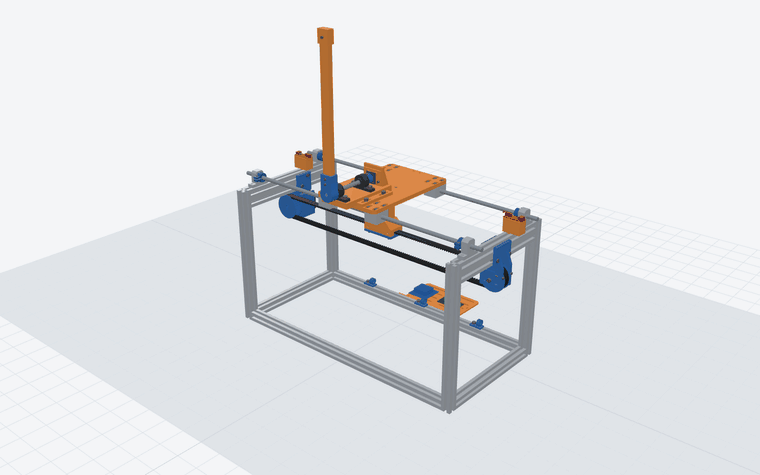

# Inverted Pendulum

### A cart-pole on a 2020 frame: the belt drive fixed and every missing part designed, all 3-D printed

[](https://github.com/AjayaDahal/inverted-pendulum/actions/workflows/gate.yml)


-2ea44f)


**[▶ Open the live 3-D viewer](https://ajayadahal.github.io/inverted-pendulum/)** ·
[Design](DESIGN.md) · [Bill of materials](BOM.md) · [Print tracker](tracker.md) ·
[Slicing](SLICING.md) · [Review report](REPORT.md)

</div>

A NEMA 17 pulls a printed carriage along two 8 mm rods with a closed HTD 8M belt. On the carriage, a
300 mm pendulum turns on an 8 mm shaft in two KP08 pillow blocks, in front of the frame, and an
AS5600 reads its angle. The controller swings it up from hanging and balances it upright.

The machine as built (frame, rods, bearings, motor, belt, sensors and boards) is kept: this
design fixes its belt drive and adds the structure it was missing, so nothing new has to be
bought. Every part is generated by Python from one parameter file, laid out and sliced from the
command line, and checked by an automated gate before any filament is used: fits, clashes, the
cart's travel, the pendulum's full turn, the belt's plane and tension range, every screw's
length, a control simulation and the G-code itself. The controller is also the firmware's:
the gate replays simulated runs through its C++ and requires the same commands. The gate runs
on every push. A premortem ([`REPORT.md`](REPORT.md#premortem-how-it-could-still-fail)) lists what
could still make the machine fail, and what was changed or must be checked for each.

## At a glance

| | |
|---|---|
| **Machine** | Cart-pole: belt-driven carriage on two 8 mm rods, pendulum on a shaft in two KP08s |
| **Frame** | The owner's 2020/2040 frame, 686 × 193 × 319 mm, from his measuring photos and tape ([measured](DESIGN.md#measure-first)) |
| **Travel** | ±241 mm to the hard stops, limit switches at ±237 mm, firmware keeps to ±231 mm |
| **Drive** | NEMA 17, his closed HTD 8M 20 mm belt on two printed 20-tooth pulleys spaced for it: 160 mm per turn, 20 steps/mm |
| **Pendulum** | 300 mm PLA arm, 112 g, turns a full circle in front of the frame at any cart position |
| **Sensor** | AS5600 magnetic encoder on the shaft's end, or a 600 P/R optical encoder |
| **Control** | Kick, energy swing-up, catch, then LQR with integral action: upright in about 3 s from hanging, in simulation |
| **Electronics** | Your stepper driver at 1.5 A and 19 V; an Arduino Uno / Nano or ESP32 runs [`firmware/pendulum`](firmware/pendulum), the simulated controller line for line |
| **Prints** | 21 part files on 6 Kobra S1 plates, no supports: PLA 364 g, PETG 248 g, about 25 h |
| **To buy** | Nothing: the machine's own parts plus plain M3/M4/M5 screws and T-nuts |

Exact numbers: [`DESIGN.md`](DESIGN.md#key-numbers). Plates, masses and times:
[`tracker.md`](tracker.md).

## The belt, fixed

<table>
<tr>
<td width="50%">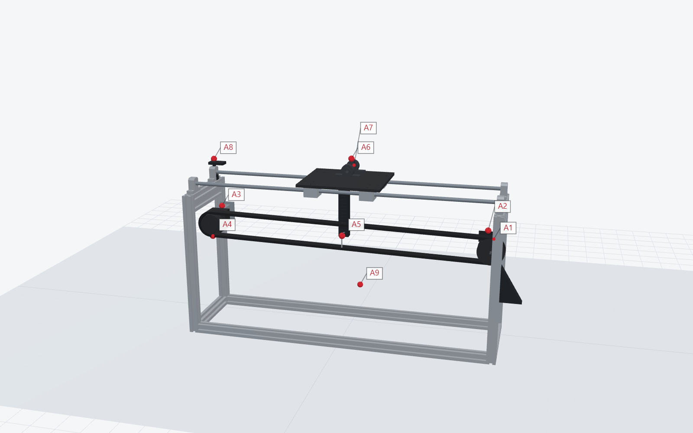<br>
<b>As built.</b> The idler hangs on a thin rod held at one end, the pulleys sit at different
heights with one flange each, and a hex key through a slotted bar holds the belt: it walks off,
slips and has play.</td>
<td width="50%">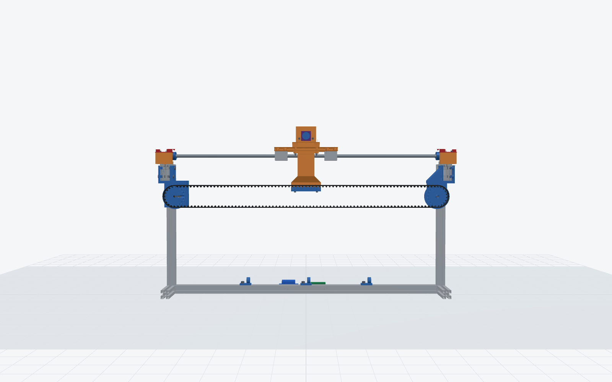<br>
<b>This design.</b> Pulleys and clamp in one plane, both axles at one height, a flange on each
side, an idler axle held at both ends with two tension screws, and a toothed clamp on a stiff
column.</td>
</tr>
</table>

Nine findings on the machine as built, each fixed here: [`REPORT.md`](REPORT.md). How the belt
runs and how to tension it: [`DESIGN.md`](DESIGN.md#how-the-belt-runs-now).

## See it move

<table>
<tr>
<td width="50%">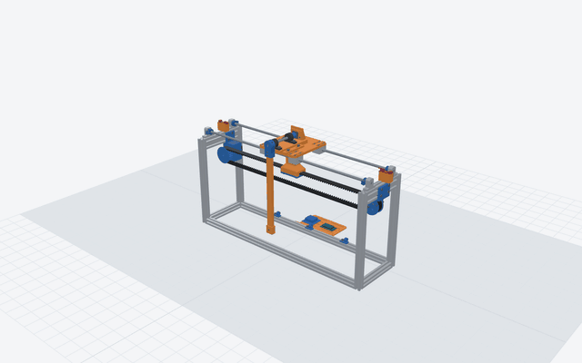<br>
<b>Swing-up.</b> The simulated controller kicks the pendulum, pumps it up from hanging and
catches it upright; the cart stays within ±144 mm (±187 mm over 48 runs with the model
off, slow reactions, pivot friction and a push).</td>
<td width="50%">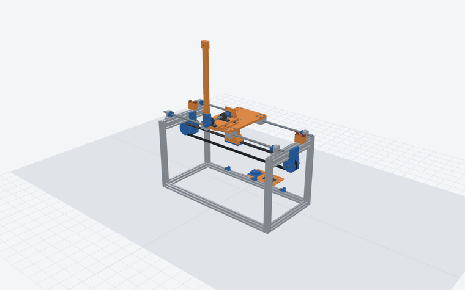<br>
<b>Burst view.</b> Every part moves out along the way it goes together.</td>
</tr>
</table>

## Explore it in 3-D

| | |
|---|---|
| 🧭 **[Live viewer](https://ajayadahal.github.io/inverted-pendulum/)** | The three.js viewer in your browser: orbit, move the cart and the pendulum, burst view, x-ray, section cuts, labels, every screw, the optical-encoder option, the machine as built with its findings, and the print plates on the bed. |
| 🧊 **[`parts/inverted_pendulum_v1.step`](parts/inverted_pendulum_v1.step)** | The whole assembly as STEP, for any CAD program. Each printed part is also an STL in [`parts/assembly/`](parts/assembly), which GitHub shows in its own 3-D viewer. |
| 💻 **`python scripts/serve_viewer.py`** | The same viewer from your clone, at <http://127.0.0.1:28767/viewer/>. |

The live viewer is this repository served by GitHub Pages (*Settings → Pages → Deploy from a
branch → `main`, `/ (root)`*); the root `index.html` opens `viewer/`.

## Gallery

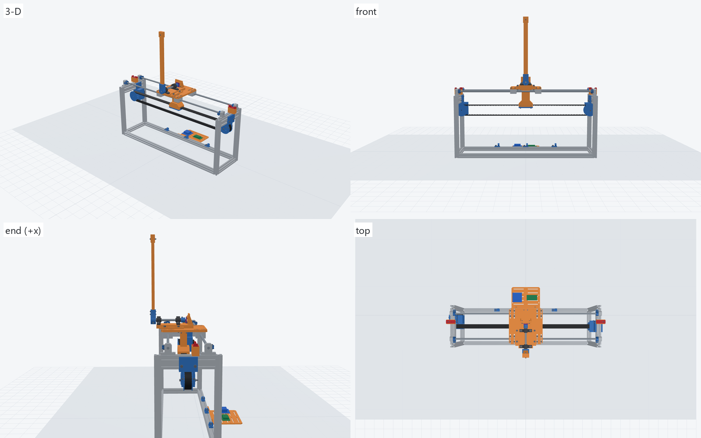

<details>
<summary><b>Details</b>: motor end, idler end and tensioner, carriage, sensor tower, belt plane</summary>
<br>
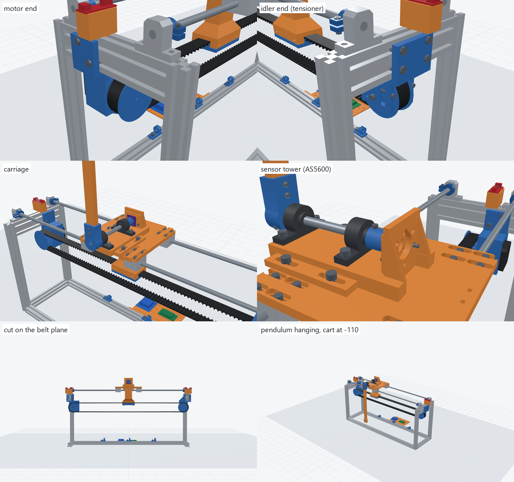
</details>

<details>
<summary><b>As built and this design</b>, side by side, findings A1–A9 marked</summary>
<br>
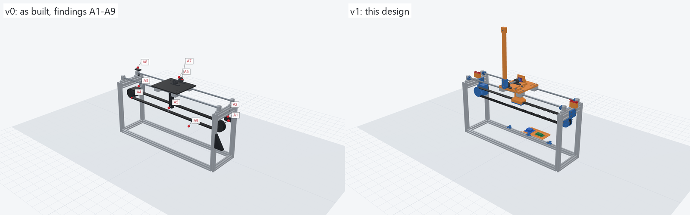
</details>

<details>
<summary><b>Labelled</b>: every printed part by name</summary>
<br>
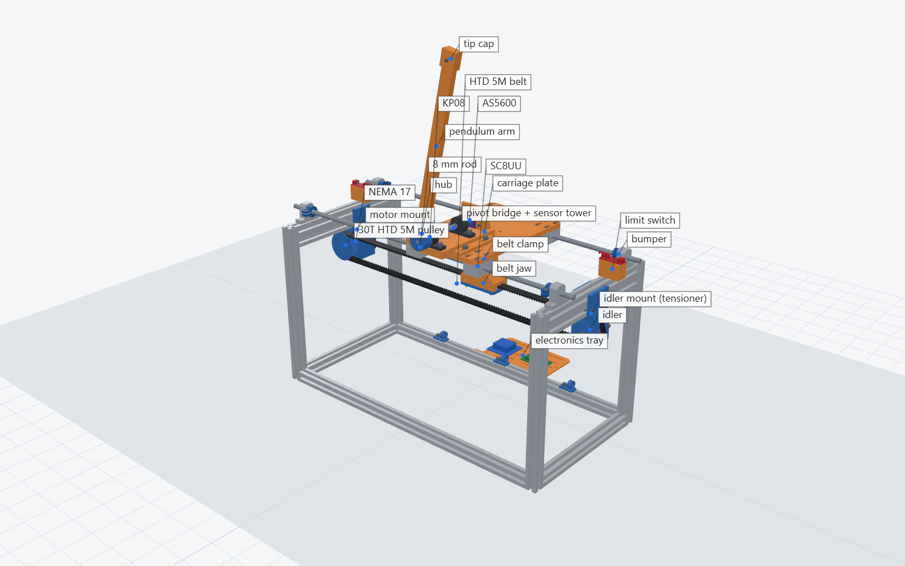
</details>

<details>
<summary><b>Print plates</b>: the six Kobra S1 plates</summary>
<br>
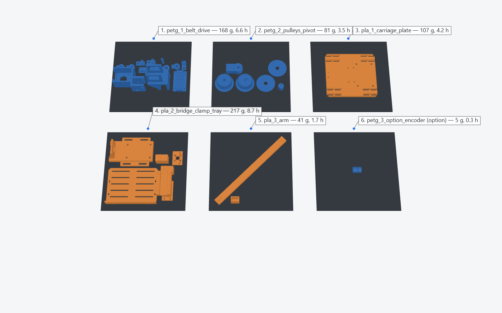
</details>

<details>
<summary><b>Simulation</b>: swing-up and balance, angle, cart position and motor force</summary>
<br>
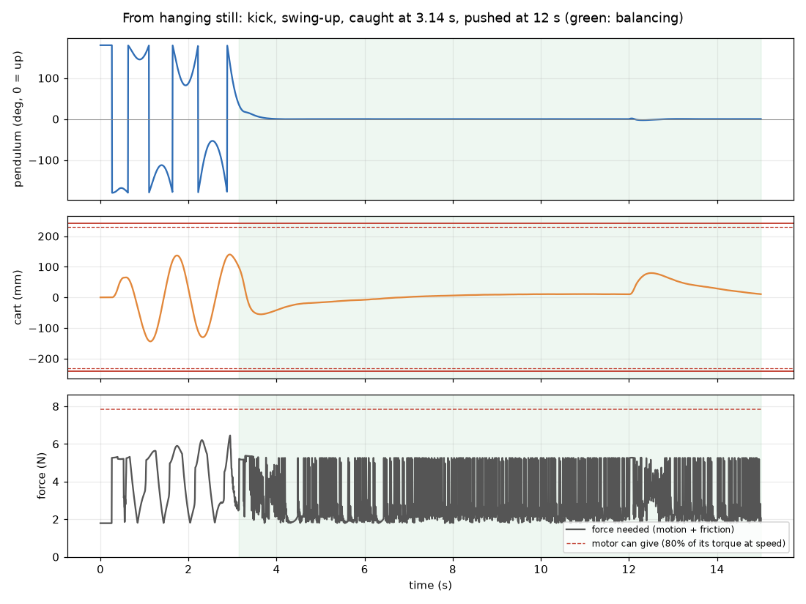
</details>

## Build it

1. **Measured**: the frame (686 × 193 × 319 mm) and the belt (175 teeth) are set in
   `scripts/params.py`; if yours differ, change them there and run
   `python scripts/build_all.py`: every part and clearance follows
   ([`DESIGN.md`](DESIGN.md#measure-first)).
2. **Print** from `3mf/to_print_kobra_s1.3mf`: one project with only the parts still to print
   (filament 1 PLA in blue, 2 PETG in orange, one material per bed: the PETG beds first, then the
   PLA ones; no part needs supports). It leaves out what you keep
   and takes one sensor's parts: set `HAVE`, `MAYBE` and `SENSOR` in `scripts/make_to_print.py`.
   Every part: `3mf/complete_project_kobra_s1.3mf`, the six plates in print order in one project
   with the same two filaments ([`tracker.md`](tracker.md), [`SLICING.md`](SLICING.md)). Before
   printing: [`REPORT.md`](REPORT.md#printing-audit-and-premortem) (how the prints could fail and
   what was changed for each).
3. **Assemble** in the order in [`DESIGN.md`](DESIGN.md#assembly-order): motor end, pulleys, idler
   and tensioner, carriage, clamp, tension, pivot (its bearings freed: the pivot's friction decides
   how still it balances), sensor, switches.
4. **Run**: load [`firmware/pendulum`](firmware/pendulum) (Arduino Uno / Nano or ESP32) and follow
   the first power-on in [`DESIGN.md`](DESIGN.md#electronics-and-firmware): homing, calibration, a
   direction test, the pivot's friction test, then swing-up and balance.

## Rebuild and check

```
pip install -r requirements.txt
python scripts/check_parts.py      # run the gate on the committed files
python scripts/serve_viewer.py     # the 3-D viewer at http://127.0.0.1:28767/viewer/
python scripts/build_all.py        # rebuild, re-slice, re-simulate and verify everything
python scripts/capture.py          # re-render renders/ (headless Edge or Chrome)
```

`build_all.py` needs Anycubic Slicer Next 2.0.0.3: set `PENDULUM_SLICER` if it is not at the
default Windows path, or pass `--no-slice` to rebuild without slicing.

## Repository

| Path | What |
|---|---|
| `scripts/params.py` | every dimension, in one file |
| `scripts/structure.py` | the 21 printed parts (build123d) |
| `scripts/vitamins.py`, `hardware.py` | the bought parts and every screw, as models |
| `scripts/asbuilt.py` | the machine as built, modelled from the photos, with its findings |
| `scripts/sim.py` | the cart-pole model and the controller: kick, swing-up, catch, LQR with integral action |
| `scripts/tune_controller.py` | searches the controller's numbers over the robustness runs |
| `scripts/check_parts.py` | the verification gate |
| `firmware/pendulum/` | the Arduino / ESP32 firmware; `config.h` is generated (`make_firmware.py`) |
| `parts/` | STLs (assembly, print-ready, bought parts, as built), the STEP, `assembly.json`, `sim.json` |
| `3mf/`, `gcode/` | the slicer projects and their G-code |
| `slicer_profiles/` | Kobra S1 printer, process and filament settings |
| `viewer/` | the three.js viewer |
| `renders/` | pictures and animations |
