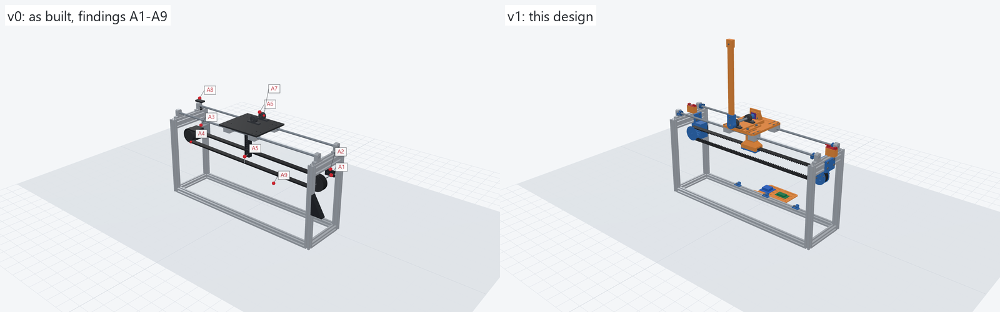

# Design review: the machine as built (v0) and this design (v1)

The owner's machine was photographed (25 photos, not published) with an NEC 19 in and an LG 22 in
monitor behind it for scale; the KP08 (55 mm), SK8 (42 mm) and NEMA 17 (42.3 mm) fixed the scale
better than the monitors. `scripts/asbuilt.py` models it (parts/as_built/, the viewer's "as built"
mode) and `scripts/check_parts.py` checks this design. The photos show a 2020 frame with 2040 top
end bars, two 8 mm rods on SK8 supports, a printed carriage plate on four SC8UU blocks, two KP08
pillow blocks, a NEMA 17, two printed pulleys and an HTD 5M belt (about 15 mm). The structure was
unfinished, and the belt did not run properly.

## Current status

| | Finding | Severity | Status |
|---|---|---|---|
| A1 | Idler on a thin rod held at one end | blocking: the belt walks | fixed in v1 (double-supported axle) |
| A2 | Idler position set by a row of holes | major: no real tension | fixed in v1 (two tension screws) |
| A3 | Motor and idler located from different posts | blocking: belt not in one plane | fixed in v1 (one plane, y = 0) |
| A4 | Single-flanged pulleys at different heights | major | fixed in v1 (flanged both sides, same height) |
| A5 | Belt link: ladder bar and a hex key | blocking: slip and backlash | fixed in v1 (stiff column, toothed jaw) |
| A6 | Pivot over the cart's middle | blocking for swing-up | fixed in v1 (pendulum in front of the frame) |
| A7 | No shaft, hub, arm or sensor mount | missing | added in v1 |
| A8 | One limit switch, no hard stops | major | fixed in v1 (bumpers + two switches) |
| A9 | Loose electronics and leads | minor | fixed in v1 (tray, clips, strain relief) |
| G1-G6 | Found by the gate while designing v1 | | all fixed (below) |
| O1-O4 | Open: to confirm on the real machine | | open (below) |

## As built (v0)

**A1. The idler's axle is a thin rod held at one end.** A printed bracket with a row of holes on the
idler-end back post holds a thin rod that reaches about 140 mm to the pulley. Belt tension pulls
the pulley with twice the tension (both runs), so the rod bends and the pulley tilts. A tilted
pulley steers the belt towards one flange and off. *v1:* the idler turns on a sleeve on an M5 axle
held at both ends by two sliders in the cheeks of a saddle that wraps the top end bar
(`idler_mount`, `idler_slider`, `idler_sleeve`).

**A2. Tension in 6 mm steps.** The axle goes in one of the bracket's holes: no fine tension, no lock,
no way to square the axle. *v1:* each slider has its own M3 tension screw from an outboard lug, so
the axle can be pulled out evenly (tension) or one side more (squaring: the belt runs centred);
the axle bolt then clamps the sliders' flanges against the cheeks.

**A3. Nothing puts the pulleys and the clamp in one plane.** The motor hangs from one post on spacers,
the idler from another post on its own bracket, the belt link from the plate: three separately
located parts. *v1:* the belt's plane is the frame's centre line (y = 0). Both pulleys sit in the end
frames' centre planes at the same height, both mounts take their place from the same kind of saddle on
the top end bars, and the belt clamp hangs from the carriage's centre. The gate checks it (`belt`).

**A4. Single-flanged pulleys at different heights.** The printed pulleys have one flange each, and
in the photos the runs slope. *v1:* new 30-tooth HTD 5M pulleys with a flange on each side (the front
one pressed on after assembly), both axles at z 226, so both runs are level and parallel to the rails;
1 mm between the belt and each flange.

**A5. The belt link slips.** A hollow bar with a ladder of slots hangs from the plate, and a hex key
through a slot holds the belt. No tooth is engaged: the link slips under load and has backlash, and
a thin-walled bar on two screws flexes. Both matter for balancing: the controller's cart position
is the stepper's, and any slip or play is error it cannot see. *v1:* `belt_clamp`, a box column
(40 x 24 mm, 3 mm walls) on four M3 screws from the plate down to the upper run, with a flat ceiling
on the belt's back and `clamp_jaw` underneath: HTD 5M tooth seats in phase with the belt's teeth,
four M3 screws. Open belt ends or a closed loop both clamp.

**A6. The pivot over the cart's middle cannot swing up.** In the latest photos the two KP08s stand in
line on the plate's back half. A pendulum on that axis sits over the carriage, between the rails: it
cannot hang past the plate or the rods, so it can only ever be balanced from upright, by hand. *v1:*
`pivot_bridge` carries both KP08s forward so the arm turns in a plane 8 mm in front of the frame's
front face: a full turn is clear at every cart position, the tip 64 mm above the desk when hanging.

**A7. Missing:** pivot shaft, hub, arm, angle sensor mount. *v1:* 8 mm x 115 mm shaft (offcut or M8
bolt), `pendulum_hub` (split clamp), `pendulum_arm` (20 x 10 mm, 300 mm to the tip), `pendulum_tip`,
AS5600 on an adapter on the sensor tower with `magnet_cap` on the shaft's end, or a 600 P/R optical
encoder on the tower's back with `coupler`.

**A8. No hard stops, one switch.** The carriage's SC8UU blocks run into the SK8 supports. *v1:*
`rod_bumper` collars stop the SC8UU blocks at +-178 mm; a `switch_mount` on each top end bar trips
its switch 4 mm before (+-174); the firmware keeps to +-168.

**A9. Loose electronics.** The driver board, controller and leads lie on the desk; the sensor lead
from the moving cart has no strain relief. *v1:* `electronics_tray` hooked to the back long member,
zip-tie bridges at the plate's back edge, `cable_clip`s in the frame's slots.

**Kept as is:** the frame, rods, SK8 supports, SC8UU blocks, KP08s, motor and belt; the black wedge
parts on the idler-end front post (their purpose is not clear from the photos; nothing in v1
touches them). The pulleys sit in the end frames under the top end bars as before, so a closed belt
that fitted v0 is likely to fit v1 (O2).

## Found by the gate while designing v1

| | What | Fix |
|---|---|---|
| G1 | The AS5600 adapter reached 6 mm into the bridge (738 mm3) | adapter starts above the bridge; its screws moved up |
| G2 | The -x switch block's locating lip hit the motor mount's saddle (140 mm3) | lip replaced by a key in the bar's top slot |
| G3 | Clamp screws M3 x 12, arm screws and tip pin M3 x 16 too short for their nuts | M3 x 16, M3 x 20, M3 x 20 |
| G4 | Catching the pendulum at 25 deg sent the cart 280-440 mm: past the stops | swing-up aims slightly above the top and the LQR takes over within 10 deg: worst case 80-90 mm |
| G5 | A bang-bang swing-up lurched the cart at the start and never settled on the top | tanh-softened energy pumping with cart centring (`sim.py`) |
| G6 | The pulley's set screw would have pressed on the round of the shaft | the bore's flat and the motor's flat both face the screw (+x) |

## Open: to confirm on the real machine

**O1. The frame's size is an estimate.** 560 x 280 x 300 mm, rods 180 mm apart. The parts that touch the
frame bolt to it locally and have slack where it matters (SC8UU holes +-5 mm: rods 170-190 apart; the
bridge slides +-10 mm, so the pendulum clears frames 260-300 wide). Measure and run
`build_all.py`; the gate re-checks every clearance (DESIGN.md, "Measure first").

**O2. The belt.** Read as HTD 5M, about 15 mm wide, from the photos. If it is a closed loop, its
length must be within the tensioner's range, printed by the gate (`belt` check); if not, cut it
once and clamp both ends (an open belt works with the same clamp).

**O3. The angle sensor.** The design takes an AS5600 board (corner holes 18-26 mm apart) and its
6 x 2.5 mm diametric magnet, or a 600 P/R optical encoder (38 mm, 6 mm shaft, M3 on 28-32 mm).

**O4. The shaft.** An 8 mm x 115 mm steel rod (or the plain part of an M8 bolt). Printed is not
an option through KP08 set screws.
